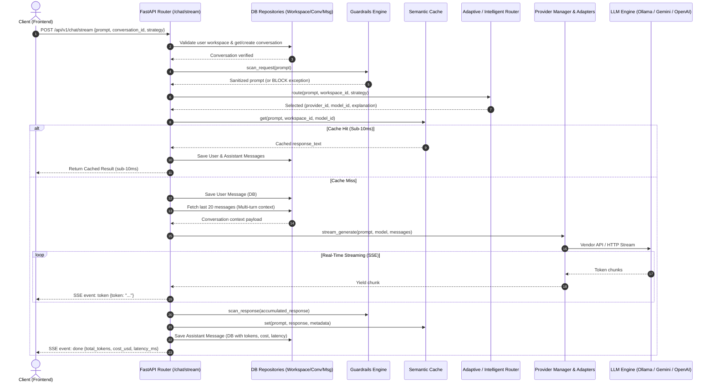
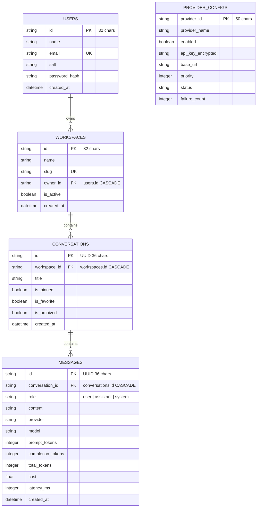

# SENTINEL AI: ARCHITECTURE & IMPLEMENTATION BLUEPRINT REPORT

**System:** SENTINEL AI Enterprise Control Plane  
**Audit Date:** August 12, 2026  
**Auditor:** Lead Software Architect & Enterprise AI Systems Engineer  
**Target Repository:** `D:/sentinal ai/sentinel-ai`  

---

## 1. EXECUTIVE SUMMARY & TECH STACK MATRIX

### Core Purpose of Sentinel AI
**SENTINEL AI** is an enterprise-grade **AI Control Plane, Governance Engine, and Multi-Provider LLM Orchestration Gateway**. Built to eliminate model lock-in and optimize AI infrastructure costs, Sentinel AI acts as an intelligent intermediary between enterprise application workloads and backend AI providers (local LLMs and cloud APIs).

Key platform capabilities detected across the codebase include:
- **Intelligent & Adaptive AI Routing:** Automated prompt profiling, workload classification, multi-factor candidate scoring, and sub-millisecond local-first or quality-optimized model selection.
- **Resilient Multi-Provider Orchestration:** Unified abstraction layer supporting Ollama, Google Gemini, OpenAI, and Anthropic with automatic failover, circuit breakers, and connection pooling.
- **Enterprise Guardrails & PII Protection:** Real-time request and response scanning for sensitive data leakage, prompt injection, and regulatory compliance.
- **Semantic Caching & AI Memory:** Hybrid TF-IDF + Cosine similarity vector caching to eliminate redundant LLM invocations and achieve sub-10ms response times for cached prompts.
- **Financial Governance (FinOps):** Token-level usage tracking, cost estimation, budget limits, forecasting, and optimization advice.
- **Enterprise Governance:** Role-Based Access Control (RBAC), Policy enforcement engines, Virtual API key management, and complete operational audit logging.

### Technology Stack Matrix

| Layer | Technology / Tool | Version / Spec | Usage in Codebase |
| :--- | :--- | :--- | :--- |
| **Backend Core** | Python / FastAPI | Python 3.10+, FastAPI `0.115.6`, Uvicorn `0.34.0` | Asynchronous REST & SSE streaming control plane API ([backend/app/main.py](file:///D:/sentinal%20ai/sentinel-ai/backend/app/main.py)). |
| **ORM & Database** | SQLAlchemy / asyncpg / PostgreSQL | SQLAlchemy `2.0.36`, asyncpg `0.30.0`, PostgreSQL 16 Alpine | Asynchronous persistence for Workspaces, Conversations, Messages, Users, and Provider Configs ([backend/app/db/session.py](file:///D:/sentinal%20ai/sentinel-ai/backend/app/db/session.py)). |
| **Database Migrations** | Alembic | Alembic `1.14.0` | Database schema migrations and table sync ([backend/alembic](file:///D:/sentinal%20ai/sentinel-ai/backend/alembic)). |
| **Frontend Framework** | JavaScript (React / Next.js) | Next.js `16.2.11`, React `18.3.1` (**NO TypeScript**, pure JS/JSX) | Client SPA and Admin Console ([frontend/app](file:///D:/sentinal%20ai/sentinel-ai/frontend/app)). |
| **Frontend Styling** | Vanilla CSS + Tailwind CSS | Tailwind CSS `3.4.16`, PostCSS | Responsive UI layout, dark theme styling ([frontend/app/globals.css](file:///D:/sentinal%20ai/sentinel-ai/frontend/app/globals.css)). |
| **Frontend UI Components** | Lucide React, Framer Motion, Recharts | Lucide `0.468.0`, Framer Motion `11.15.0`, Recharts `2.15.0` | Interactive charts, animations, icons, and shell components ([frontend/components](file:///D:/sentinal%20ai/sentinel-ai/frontend/components)). |
| **Caching & Ephemeral Store** | Redis | Redis `7-alpine`, redis-py `5.2.1` | Ephemeral caching, rate limiting, and session state ([backend/app/cache/client.py](file:///D:/sentinal%20ai/sentinel-ai/backend/app/cache/client.py)). |
| **Vector Database** | Qdrant | Qdrant `v1.12.1` (Docker) | Vector database container in Compose; payload prep module ([backend/app/context/vector_prep.py](file:///D:/sentinal%20ai/sentinel-ai/backend/app/context/vector_prep.py)). |
| **Local LLM Engine** | Ollama | Ollama `latest` (Docker) | Zero-cost local execution engine for Llama 3.2, DeepSeek R1, Mistral ([backend/app/providers/ollama_provider.py](file:///D:/sentinal%20ai/sentinel-ai/backend/app/providers/ollama_provider.py)). |
| **Cloud AI Adapters** | Google Gemini, OpenAI, Anthropic | `google-genai 2.12.1`, `openai 2.46.0`, HTTPX | Cloud LLM integration adapters ([backend/app/providers](file:///D:/sentinal%20ai/sentinel-ai/backend/app/providers)). |
| **Containerization** | Docker / Docker Compose | Docker Compose v3.8 | Local & Prod service orchestrations ([docker-compose.yml](file:///D:/sentinal%20ai/sentinel-ai/docker-compose.yml), [docker-compose.prod.yml](file:///D:/sentinal%20ai/sentinel-ai/docker-compose.prod.yml)). |

> [!IMPORTANT]  
> **Strict Stack Validation Statement:**  
> Audit confirms that the SENTINEL AI codebase strictly uses **Python** (FastAPI / SQLAlchemy), **JavaScript** (Next.js / React — *strictly no TypeScript files present in frontend*), **Docker Compose**, **Redis**, **Qdrant**, **PostgreSQL**, **Ollama**, and **Gemini** (along with OpenAI and Anthropic provider adapters).

---

## 2. REPOSITORY & DIRECTORY MAP

```
sentinel-ai/
├── docker-compose.yml               # Local development container orchestration (Postgres, Redis, Qdrant, Ollama, Backend, Frontend)
├── docker-compose.prod.yml          # Production container configuration
├── requirements.txt                 # Root Python requirements
├── backend/
│   ├── Dockerfile & Dockerfile.prod # Backend container builds
│   ├── alembic.ini & alembic/      # Database migration scripts
│   └── app/
│       ├── main.py                  # FastAPI application entry point & router inclusions
│       ├── api/                     # Transport layer & HTTP REST routers
│       │   ├── dependencies.py      # Auth, DB, User context injection dependencies
│       │   └── routers/             # 26 specialized API routers (chat, providers, routing, cost, etc.)
│       ├── audit/                   # Compliance event recorder & search engine
│       ├── auth/                    # JWT authentication & session services
│       ├── cache/                   # Semantic cache, Redis client, and vector store
│       ├── chat/                    # Core chat service, prompt builder, DTOs, and repository
│       ├── context/                 # File chunking & vector preparation engine
│       ├── core/                    # Settings (pydantic-settings), logging, metrics, lifecycle
│       ├── cost/                    # Token pricing engine, cost calculator, estimator
│       ├── db/                      # SQLAlchemy AsyncEngine setup & declarative Base
│       ├── finops/                  # Financial analytics, budget limits, forecasting engine
│       ├── guardrails/              # PII detection, secret scanning, request/response redaction
│       ├── history/                 # Search engine for past prompts and responses
│       ├── models/                  # SQLAlchemy ORM Data Models (User, Workspace, Conversation, Message, ProviderConfig)
│       ├── models_registry/         # Central Model Registry & static catalog definitions
│       ├── observability/           # Distributed trace engine, telemetry aggregator, replay
│       ├── orchestration/           # Adaptive Router, Intent Detector, Capability Engine
│       ├── policy/                  # Policy evaluation engine & rules repository
│       ├── providers/               # Provider abstraction manager & vendor adapters (Ollama, Gemini, OpenAI, Anthropic)
│       ├── rbac/                    # Role-Based Access Control engine & permission matrix
│       ├── reliability/             # Circuit breakers, bulkhead, connection pooling, rate limiters
│       ├── repositories/            # Data Access Objects (Workspace, Conversation, Message)
│       ├── routing/                 # IntelligentRouter, scoring strategies, classification
│       ├── security/                # Virtual API keys, secrets manager, security auditor
│       ├── services/                # File upload service, workspace service
│       ├── simulation/              # Policy simulator & optimization advisor
│       ├── streaming/               # StreamManager & active SSE session tracking
│       ├── tenancy/                 # Multi-tenant organization engine & SSO
│       └── workspace/               # Workspace management services and DTOs
└── frontend/
    ├── package.json                 # Next.js 16 / React 18 dependencies
    ├── next.config.js               # Next.js configuration & proxy rules
    ├── app/                         # Next.js App Router pages (24 views)
    │   ├── page.js                  # Main Workspace / Chat Interface
    │   ├── layout.js & globals.css  # Root layout & styling design tokens
    │   ├── analytics/page.js        # Analytics telemetry dashboard
    │   ├── finops/page.js           # FinOps cost control panel
    │   ├── guardrails/page.js       # Guardrails rule editor & scanner
    │   ├── models/page.js           # Model Catalog & capability matrix
    │   ├── observability/page.js    # Trace inspection & execution timeline replay
    │   ├── policies/page.js         # Governance policies manager
    │   ├── providers/page.js        # Provider configuration & health dashboard
    │   ├── routing-center/page.js   # Smart Router control panel
    │   ├── virtual-keys/page.js     # Virtual API key administration
    │   └── ...                      # Additional admin views (audit, cache, health, roles, tenancy)
    ├── components/                  # React UI Component Library
    │   ├── shell.js                 # App Shell & Navigation Sidebar
    │   ├── ProtectedRoute.js        # Client-side JWT auth guard
    │   ├── chat/                    # Chat UI (ChatWindow, ConversationSidebar, MessageBubble, MessageInput)
    │   └── landing/                 # Public marketing landing page components
    └── lib/
        ├── api.js                   # API Client SDK & cached fetch helper
        └── storage.js               # LocalStorage abstraction wrapper
```

### Module Responsibilities

| Subsystem | Key Files | Primary Responsibilities |
| :--- | :--- | :--- |
| **API Transport** | [backend/app/main.py](file:///D:/sentinal%20ai/sentinel-ai/backend/app/main.py), [backend/app/api/routers/chat.py](file:///D:/sentinal%20ai/sentinel-ai/backend/app/api/routers/chat.py) | Exposes FastAPI endpoints, handles CORS, request middleware, Prometheus metrics exposition, and SSE streaming. |
| **Core Chat Engine** | [backend/app/chat/service.py](file:///D:/sentinal%20ai/sentinel-ai/backend/app/chat/service.py), [backend/app/chat/prompt_builder.py](file:///D:/sentinal%20ai/sentinel-ai/backend/app/chat/prompt_builder.py) | Coordinates chat generation, conversation context construction, pre-checks, provider execution, fallback retry loops, and SSE token streaming. |
| **Model Registry** | [backend/app/models_registry/registry.py](file:///D:/sentinal%20ai/sentinel-ai/backend/app/models_registry/registry.py), [default_catalog.py](file:///D:/sentinal%20ai/sentinel-ai/backend/app/models_registry/catalog/default_catalog.py) | Single source of truth for provider and model metadata, pricing, capabilities, context limits, and dynamic Ollama tag registration. |
| **Routing Brain** | [backend/app/orchestration/router.py](file:///D:/sentinal%20ai/sentinel-ai/backend/app/orchestration/router.py), [backend/app/routing/router.py](file:///D:/sentinal%20ai/sentinel-ai/backend/app/routing/router.py) | 5-stage intent profiling, workload complexity evaluation, multi-factor candidate scoring, local-first rule evaluation, and explainable routing traces. |
| **Provider Adapters** | [backend/app/providers/manager.py](file:///D:/sentinal%20ai/sentinel-ai/backend/app/providers/manager.py), [ollama_provider.py](file:///D:/sentinal%20ai/sentinel-ai/backend/app/providers/ollama_provider.py), [gemini_provider.py](file:///D:/sentinal%20ai/sentinel-ai/backend/app/providers/gemini_provider.py) | Abstraction layer managing provider health status, credential configuration, connection testing, and unified `generate` / `stream_generate` / `embed` invocations. |
| **AI Memory & Cache** | [backend/app/cache/semantic.py](file:///D:/sentinal%20ai/sentinel-ai/backend/app/cache/semantic.py), [store.py](file:///D:/sentinal%20ai/sentinel-ai/backend/app/cache/store.py) | Enterprise semantic vector cache with hybrid TF-IDF + Cosine similarity, fingerprint validation, memory ranking, and LRU eviction protection. |
| **Data Repositories** | [backend/app/repositories/](file:///D:/sentinal%20ai/sentinel-ai/backend/app/repositories) | Data Access Objects wrapping SQLAlchemy sessions for Workspaces, Conversations, and Messages. |
| **Frontend Workspace** | [frontend/app/page.js](file:///D:/sentinal%20ai/sentinel-ai/frontend/app/page.js), [frontend/components/chat/ChatWindow.js](file:///D:/sentinal%20ai/sentinel-ai/frontend/components/chat/ChatWindow.js) | Main chat UI handling real-time SSE stream parsing (`EventSource`/`fetch`), message history rendering, and workspace sidebar interactions. |

---

## 3. CORE CHAT & STREAMING EXECUTION LOOP

The core execution loop processes incoming prompts end-to-end through validation, routing, provider execution, SSE streaming, and post-execution telemetry recording.



### Traceability Index of Key Functions in the Loop

1. **Frontend Submission & SSE Handling:**
   - File: [`frontend/components/chat/ChatWindow.js`](file:///D:/sentinal%20ai/sentinel-ai/frontend/components/chat/ChatWindow.js)
   - Function: `handleSend()` — Initiates `fetch('/api/v1/chat/stream')`, sets up a `ReadableStream` reader, and parses SSE events (`event: metadata`, `event: pipeline`, `event: routing`, `event: token`, `event: done`).
2. **Backend API Endpoint:**
   - File: [`backend/app/api/routers/chat.py`](file:///D:/sentinal%20ai/sentinel-ai/backend/app/api/routers/chat.py)
   - Function: `stream_generate(request, db, user)` — Resolves user workspace, constructs a `StreamingResponse` wrapping `chat_service.stream_generate()`.
3. **Workspace & Conversation Retrieval / Persistence:**
   - File: [`backend/app/chat/service.py`](file:///D:/sentinal%20ai/sentinel-ai/backend/app/chat/service.py)
   - Functions: `_stream_generate_impl()` & `_generate_smart_title()` — Uses `ConversationRepository.get()` or `ConversationRepository.create()` to establish conversation state.
4. **Pre-Execution Scanning & Memory Lookup:**
   - Files: [`backend/app/guardrails/engine.py`](file:///D:/sentinal%20ai/sentinel-ai/backend/app/guardrails/engine.py) & [`backend/app/cache/semantic.py`](file:///D:/sentinal%20ai/sentinel-ai/backend/app/cache/semantic.py)
   - Functions: `guardrails_engine.scan_request(prompt)` and `semantic_cache.get(prompt, workspace_id, model_id)`.
5. **Smart Routing Query:**
   - Files: [`backend/app/orchestration/router.py`](file:///D:/sentinal%20ai/sentinel-ai/backend/app/orchestration/router.py) & [`backend/app/routing/router.py`](file:///D:/sentinal%20ai/sentinel-ai/backend/app/routing/router.py)
   - Function: `_resolve_routing(data)` — Invokes `adaptive_router.route()` or `IntelligentRouter.evaluate_with_explanation()`.
6. **Provider Execution & SSE Generation:**
   - Files: [`backend/app/providers/manager.py`](file:///D:/sentinal%20ai/sentinel-ai/backend/app/providers/manager.py) & individual adapters ([`ollama_provider.py`](file:///D:/sentinal%20ai/sentinel-ai/backend/app/providers/ollama_provider.py), [`gemini_provider.py`](file:///D:/sentinal%20ai/sentinel-ai/backend/app/providers/gemini_provider.py))
   - Function: `cand_provider.stream_generate(prompt, model, messages)` — Yields string tokens directly into the SSE stream generator.
7. **Post-Execution Persistence & Analytics:**
   - File: [`backend/app/chat/service.py`](file:///D:/sentinal%20ai/sentinel-ai/backend/app/chat/service.py)
   - Functions: `MessageRepository.create()`, `semantic_cache.set()`, `continuous_learning_engine.record_execution()`, and `adaptive_router.record_execution_feedback()`.

---

## 4. SMART ROUTER & MODEL REGISTRY DEEP-DIVE

### Model Registry Architecture
The Model Registry ([`backend/app/models_registry/registry.py`](file:///D:/sentinal%20ai/sentinel-ai/backend/app/models_registry/registry.py)) is the central authority for provider capabilities, latency SLA estimates, context window limits, and token pricing rates.

- **Initialization:** Populated at application startup using default static catalog data ([`default_catalog.py`](file:///D:/sentinal%20ai/sentinel-ai/backend/app/models_registry/catalog/default_catalog.py)), defining providers (`openai`, `gemini`, `anthropic`, `ollama`) and 13 models (e.g., `gpt-4o`, `gemini-2.0-flash`, `claude-3-5-sonnet`, `llama3.2`, `deepseek-r1`).
- **Dynamic Local Model Discovery:** If an unlisted model is requested from Ollama (e.g., `ollama/qwen2.5:7b`), `ModelRegistry.get_model()` dynamically instantiates a zero-cost `ModelMetadata` record with default 128k context window and standard chat capabilities, preventing lookup crashes.

### Routing Decision Flow & Scoring Formula
Routing is driven by `AdaptiveRouter` ([`backend/app/orchestration/router.py`](file:///D:/sentinal%20ai/sentinel-ai/backend/app/orchestration/router.py)) and supported by `IntelligentRouter` ([`backend/app/routing/router.py`](file:///D:/sentinal%20ai/sentinel-ai/backend/app/routing/router.py)).

```
Prompt -> Intent Profiler -> Modality/Constraint Filter -> Health & Circuit Breaker Filter -> Multi-Factor Score -> Selected Candidate
```

**Scoring Equation:**  
For each active candidate model, `AdaptiveRouter` calculates a multi-factor weighted score:

$$\text{Base Score} = \left( S_{\text{reasoning}} \cdot w_{\text{reasoning}} + S_{\text{coding}} \cdot w_{\text{coding}} + S_{\text{factual}} \cdot w_{\text{factual}} + S_{\text{cost}} \cdot w_{\text{cost}} + S_{\text{latency}} \cdot w_{\text{latency}} + S_{\text{privacy}} \cdot w_{\text{privacy}} + S_{\text{quality}} \cdot 0.15 \right) \cdot H_{\text{multiplier}}$$

Where:
- Weights ($w_i$) are dynamically derived from prompt intent analysis (e.g., code generation increases $w_{\text{coding}}$ to 0.35).
- **Local-First Rule:** Local models (e.g., Ollama `llama3.2`) receive an automatic `+0.30` score boost if privacy sensitivity $> 0.3$ or workload complexity is standard, giving zero-cost local execution highest priority.
- $H_{\text{multiplier}}$ is a self-healing health factor (ranging from `0.2` to `1.0`) based on recent execution feedback.

### Provider-Agnostic Check
- **Verification:** The router **does NOT rely on hardcoded vendor logic**. Candidate filtering checks generic flags (`cap.supports_chat`, `cap.context_window`, `provider_manager.is_active(p)`).
- If a new provider adapter is added to `ProviderManager`, the router automatically discovers and scores its models without requiring code changes in `AdaptiveRouter`.

### Automatic Failover Strategy & Mechanics
If the primary selected model fails or is degraded:
1. **Circuit Breaker Check:** If a provider fails 3 consecutive requests, `AdaptiveRouter` sets its circuit breaker to `OPEN` for 60 seconds (`_circuit_open_until`), bypassing it during initial candidate selection.
2. **Ordered Failover Chain:** In `chat_service.stream_generate()`, a candidate failover list is constructed from active providers:
   - Primary Candidate (e.g., `gemini/gemini-2.0-flash`)
   - Secondary Fallbacks (e.g., `ollama/llama3.2` $\rightarrow$ `openai/gpt-4o-mini`)
3. **Execution Loop:** If `gemini` raises a network error, HTTP 429 rate limit, or timeout, the loop emits an SSE `warning` event (`"Automatically failing over to ollama..."`) and instantly executes the next candidate in the fallback chain without dropping the user's stream.

---

## 5. PROVIDER ARCHITECTURE & ADAPTERS

### Abstract Interface (`BaseProvider`)
All AI integrations inherit from `BaseProvider` ([`backend/app/providers/base.py`](file:///D:/sentinal%20ai/sentinel-ai/backend/app/providers/base.py)), enforcing a unified operational contract:

```python
class BaseProvider(ABC):
    @property
    @abstractmethod
    def name(self) -> str: ...
    @abstractmethod
    async def generate(self, prompt: str, **options: Any) -> str: ...
    @abstractmethod
    async def stream_generate(self, prompt: str, **options: Any): ...
    @abstractmethod
    async def embed(self, text: str, **options: Any) -> list[float]: ...
    @abstractmethod
    async def health(self) -> dict[str, Any]: ...
    @abstractmethod
    async def test_connection(self) -> dict[str, Any]: ...
    def configure(self, **options: Any) -> None: ...
```

### Concrete Provider Implementations Found in Code

1. **Ollama Adapter ([`ollama_provider.py`](file:///D:/sentinal%20ai/sentinel-ai/backend/app/providers/ollama_provider.py)):**
   - Communicates with Ollama daemon via Async `httpx.AsyncClient` over HTTP (`/api/chat`, `/api/generate`, `/api/embed`, `/api/tags`).
   - Supports model auto-tag resolution and automatic model pulling via `/api/pull` if an unpulled model returns HTTP 404.
2. **Gemini Adapter ([`gemini_provider.py`](file:///D:/sentinal%20ai/sentinel-ai/backend/app/providers/gemini_provider.py)):**
   - Integrates with Google's official `google-genai` SDK (`google.genai.Client`).
   - Uses `client.models.generate_content()` and `client.models.generate_content_stream()` for native streaming.
3. **OpenAI Adapter ([`openai_provider.py`](file:///D:/sentinal%20ai/sentinel-ai/backend/app/providers/openai_provider.py)):**
   - Uses `openai.AsyncOpenAI` client targeting standard `chat.completions.create(stream=True)`.
4. **Anthropic Adapter ([`anthropic_provider.py`](file:///D:/sentinal%20ai/sentinel-ai/backend/app/providers/anthropic_provider.py)):**
   - Async HTTP integration targeting Anthropic Messages API (`/v1/messages`).

### Discovery, Health-Checking & Credential Validation
Managed by `ProviderManager` ([`backend/app/providers/manager.py`](file:///D:/sentinal%20ai/sentinel-ai/backend/app/providers/manager.py)):
- **Single Source of Truth (`is_active(name)`):** Returns `True` only if the provider is registered, `enabled == True`, credentials exist (non-empty API key for cloud APIs or valid `base_url` for Ollama), and status is in `('healthy', 'configured', 'active')`.
- **Live Connection Testing (`test_connection(name)`):** Executes a live, minimal probe to the vendor API, measuring latency in milliseconds, checking key validity, and recording failure counts.

---

## 6. AI MEMORY, CACHING & DATA PERSISTENCE

### PostgreSQL Database Schema
Defined via SQLAlchemy models in [`backend/app/models/`](file:///D:/sentinal%20ai/sentinel-ai/backend/app/models):



### Redis Usage
- **Client Lifecycle:** Initialized in [`backend/app/cache/client.py`](file:///D:/sentinal%20ai/sentinel-ai/backend/app/cache/client.py) via `redis.from_url(settings.redis_url)`.
- **Primary Roles:** Ephemeral rate-limiting counters, token bucket tracking, streaming state session storage, and fallback key-value store. Designed with graceful failure (API continues operating even if Redis is offline).

### Qdrant & Vector Store Usage
- **Container Specification:** `qdrant/qdrant:v1.12.1` exposed on ports `6333`/`6334` in [`docker-compose.yml`](file:///D:/sentinal%20ai/sentinel-ai/docker-compose.yml).
- **Payload Preparation:** [`backend/app/context/vector_prep.py`](file:///D:/sentinal%20ai/sentinel-ai/backend/app/context/vector_prep.py) prepares payload dictionaries formatted specifically for Qdrant collection points (`chunk_id`, `document_id`, `workspace_id`, `vector`).
- **Semantic Caching Engine:** [`backend/app/cache/semantic.py`](file:///D:/sentinal%20ai/sentinel-ai/backend/app/cache/semantic.py) currently implements an in-memory, 128-dimensional L2-normalized TF-IDF vector embedding engine and `CacheStore` with hybrid Cosine + Jaccard similarity scoring (`calculate_confidence()`), scoped strictly per `workspace_id`.

---

## 7. FRONTEND ARCHITECTURE (MODE 1: VISIBLE WORKSPACE & ADMIN)

### State Management & API Client Patterns
- **Architecture:** Pure JavaScript Next.js 16 App Router application. Component state managed via standard React hooks (`useState`, `useEffect`, `useCallback`, `useRef`).
- **API SDK Layer:** [`frontend/lib/api.js`](file:///D:/sentinal%20ai/sentinel-ai/frontend/lib/api.js) provides a centralized API client wrapper (`api`) handling JWT bearer authentication, automatic 401 token refresh (`/auth/refresh`), custom events (`sentinel:session-expired`), and a 15-second TTL in-memory request cache (`cachedRequest()`).

### Active Pages & UI Navigation Matrix

| View Path | Component / Page | Functional Purpose |
| :--- | :--- | :--- |
| `/` | [`frontend/app/page.js`](file:///D:/sentinal%20ai/sentinel-ai/frontend/app/page.js) | Main Workspace Chat Interface & Prompt Bar |
| `/providers` | [`frontend/app/providers/page.js`](file:///D:/sentinal%20ai/sentinel-ai/frontend/app/providers/page.js) | Provider credentials, status toggles, health checks, and failover chains |
| `/models` | [`frontend/app/models/page.js`](file:///D:/sentinal%20ai/sentinel-ai/frontend/app/models/page.js) | Model Catalog, pricing editor, and capability matrix viewer |
| `/routing-center` | [`frontend/app/routing-center/page.js`](file:///D:/sentinal%20ai/sentinel-ai/frontend/app/routing-center/page.js) | Smart Router strategy selector, score simulator, and intent metrics |
| `/finops` | [`frontend/app/finops/page.js`](file:///D:/sentinal%20ai/sentinel-ai/frontend/app/finops/page.js) | Cost analytics, workspace budgets, spend forecasting, and cost optimization |
| `/policies` | [`frontend/app/policies/page.js`](file:///D:/sentinal%20ai/sentinel-ai/frontend/app/policies/page.js) | Policy rules manager, constraint filters, and action definitions |
| `/observability` | [`frontend/app/observability/page.js`](file:///D:/sentinal%20ai/sentinel-ai/frontend/app/observability/page.js) | Distributed trace viewer and step-by-step request timeline replay |
| `/guardrails` | [`frontend/app/guardrails/page.js`](file:///D:/sentinal%20ai/sentinel-ai/frontend/app/guardrails/page.js) | PII detector configuration and real-time prompt scanning laboratory |
| `/virtual-keys` | [`frontend/app/virtual-keys/page.js`](file:///D:/sentinal%20ai/sentinel-ai/frontend/app/virtual-keys/page.js) | Virtual API Key creation, model scoping, rotation, and revocation |

### Client-Side SSE / Streaming Response Processing
In [`frontend/components/chat/ChatWindow.js`](file:///D:/sentinal%20ai/sentinel-ai/frontend/components/chat/ChatWindow.js):
1. **Connection Setup:** Sends `POST` request to `/api/v1/chat/stream` with `headers: { Authorization: 'Bearer ...' }`.
2. **Chunk Reading:** Obtains `response.body.getReader()` and decodes `Uint8Array` stream line-by-line.
3. **Event Dispatch:**
   - `event: metadata` $\rightarrow$ Captures `stream_id`, `conversation_id`, active `provider`, and `model`.
   - `event: pipeline` $\rightarrow$ Updates live pipeline stage status badges in UI ("Analyzing", "Guardrails", "Provider selected", "Generating").
   - `event: routing` $\rightarrow$ Renders routing explanation details drawer.
   - `event: token` $\rightarrow$ Appends token chunk to assistant message state in real time.
   - `event: done` $\rightarrow$ Finalizes streaming state, displays token count, latency, and cost telemetry.

---

## 8. DEVELOPER GATEWAY STATUS (MODE 2: INVISIBLE GATEWAY)

### Audit Findings for Mode 2 (Developer Proxy Gateway)
- **Virtual API Key Management:** Fully implemented at API level ([`backend/app/api/routers/virtual_keys.py`](file:///D:/sentinal%20ai/sentinel-ai/backend/app/api/routers/virtual_keys.py)) and security layer ([`backend/app/security/keys.py`](file:///D:/sentinal%20ai/sentinel-ai/backend/app/security/keys.py)). Users can generate scoped Virtual Keys (`sk-sentinel-...`) with provider/model permissions and expiry dates.
- **OpenAI-Compatible Proxy Endpoints:** **NOT IMPLEMENTED.**  
  A grep search for standard OpenAI proxy routes (`/v1/chat/completions`, `/v1/models`, `/v1/embeddings`) confirms these router paths do not currently exist in `backend/app/api/routers/`.

> [!WARNING]  
> **Mode 2 Status: INCOMPLETE / GAP**  
> While Sentinel AI works seamlessly as a visible web application (Mode 1), developers **cannot yet point third-party OpenAI SDKs** (e.g., Python `openai.OpenAI(base_url="http://localhost:8000/v1", api_key="sk-sentinel-...")`) directly at Sentinel AI.

### Architectural Blueprint to Enable Mode 2 Gateway
To make Mode 2 fully operational, the following components must be added to the backend:
1. **OpenAI Gateway Router (`backend/app/api/routers/openai_gateway.py`):**
   - Expose `POST /v1/chat/completions`, `GET /v1/models`, and `POST /v1/embeddings`.
2. **Virtual Key Bearer Authentication Middleware:**
   - Authenticate incoming requests by checking `Authorization: Bearer sk-sentinel-...` against `virtual_key_repository.validate_key()`.
3. **Request & Response Transformer:**
   - Translate standard OpenAI payload JSON (`messages`, `temperature`, `model`) into `ChatRequest`, route through `ChatService`, and format output back into OpenAI JSON or SSE chunks (`data: {"choices": [{"delta": {"content": "..."}}]}`).

---

## 9. COMPREHENSIVE RUNTIME & BUGS AUDIT (WHAT IS BROKEN / INCOMPLETE)

### 1. Database Foreign Key & Default Workspace ID Mismatch
- **Issue:** In [`backend/app/chat/service.py`](file:///D:/sentinal%20ai/sentinel-ai/backend/app/chat/service.py), fallback logic uses `workspace_id = data.workspace_id or "default"`. Meanwhile, `WorkspaceRepository.create()` generates unique workspace IDs like `ws_a1b2c3d4...`.
- **Impact:** If `data.workspace_id` is omitted or unauthenticated calls fallback to `"default"`, creating a `Conversation` fails with a `ForeignKeyViolationError` against `workspaces.id` unless a workspace with literal ID `"default"` exists in PostgreSQL.

### 2. In-Memory Persistence vs. Database Backing Discrepancy
- **Issue:** Multiple enterprise modules maintain operational data exclusively in Python process memory rather than persisting to PostgreSQL tables:
  - Audit Logs ([`backend/app/audit/engine.py`](file:///D:/sentinal%20ai/sentinel-ai/backend/app/audit/engine.py)) stored in `list[AuditEvent]` memory array.
  - Virtual API Keys ([`backend/app/security/repository.py`](file:///D:/sentinal%20ai/sentinel-ai/backend/app/security/repository.py)) stored in memory dictionary.
  - FinOps Budgets & Spend ([`backend/app/finops/repository.py`](file:///D:/sentinal%20ai/sentinel-ai/backend/app/finops/repository.py)) stored in memory dictionary.
  - Observability Traces ([`backend/app/observability/repository.py`](file:///D:/sentinal%20ai/sentinel-ai/backend/app/observability/repository.py)) stored in memory dictionary.
- **Impact:** All audit records, virtual keys, custom budgets, and observability traces are **permanently lost whenever the backend container restarts or scales to multiple workers**.

### 3. Missing Infrastructure in Production Docker Compose
- **Issue:** [`docker-compose.prod.yml`](file:///D:/sentinal%20ai/sentinel-ai/docker-compose.prod.yml) contains definitions only for `backend`, `postgres`, and `redis`. `ollama` and `qdrant` services and volumes are completely omitted.
- **Impact:** Deploying in production using `docker-compose.prod.yml` causes local LLM execution (Ollama) and Qdrant operations to fail immediately due to missing host networking/containers.

### 4. Client Connection Closure & Stream Disconnect Stalls
- **Issue:** In [`backend/app/chat/service.py`](file:///D:/sentinal%20ai/sentinel-ai/backend/app/chat/service.py), `session.is_cancelled()` is checked during streaming iterations. However, native browser `EventSource` closures or network aborts do not automatically post to `/chat/stream/{id}/cancel`.
- **Impact:** If a user closes the browser tab mid-generation, the backend provider loop continues executing LLM generation tasks in the background, consuming unneeded GPU/API tokens.

### 5. Overlapping & Duplicate Routing Architectures
- **Issue:** The codebase contains two separate routing engines:
  1. `IntelligentRouter` in [`backend/app/routing/router.py`](file:///D:/sentinal%20ai/sentinel-ai/backend/app/routing/router.py) (uses `BalancedStrategy`, `FastestStrategy`, `CheapestStrategy`).
  2. `AdaptiveRouter` in [`backend/app/orchestration/router.py`](file:///D:/sentinal%20ai/sentinel-ai/backend/app/orchestration/router.py) (uses 5-stage intent profiling and workload intelligence).
- **Impact:** [`backend/app/chat/service.py`](file:///D:/sentinal%20ai/sentinel-ai/backend/app/chat/service.py) contains conditional branches trying to invoke both routers, leading to redundant candidate evaluations and fragmented metric tracking.

### 6. Disconnected Qdrant Integration in Primary Semantic Cache
- **Issue:** `qdrant/qdrant` container runs in Docker Compose, and [`vector_prep.py`](file:///D:/sentinal%20ai/sentinel-ai/backend/app/context/vector_prep.py) formats payloads, but `SemanticCache` ([`semantic.py`](file:///D:/sentinal%20ai/sentinel-ai/backend/app/cache/semantic.py)) interacts only with an in-memory Python dictionary (`CacheStore`).
- **Impact:** Vector search does not scale across process restarts or horizontally across multiple FastAPI Uvicorn workers.

---

## 10. STABILIZATION ROADMAP & ACTION ITEMS

To elevate SENTINEL AI to 100% production readiness, the following prioritized stabilization checklist must be executed:

### Phase 1: High-Priority Production Fixes (P0)
- [ ] **Fix DB Default Workspace Seeding:** Ensure `lifecycle.py` creates a default workspace (`id="default"`) and default system user upon database initialization, guaranteeing foreign key integrity for unauthenticated or default workspace queries.
- [ ] **Unify Docker Compose Specs:** Add `ollama` (with persistent `/root/.ollama` volume mount) and `qdrant` services to `docker-compose.prod.yml` to achieve parity with development infrastructure.
- [ ] **Implement Database Persistence for Memory Repositories:** Create SQLAlchemy database models and Alembic migrations for Audit Logs, Virtual Keys, Policies, FinOps Budgets, and Observability Traces, replacing ephemeral in-memory dictionaries.

### Phase 2: Gateway & Stream Stabilization (P1)
- [ ] **Implement Mode 2 Developer Gateway:** Add `backend/app/api/routers/openai_gateway.py` exposing `/v1/chat/completions`, `/v1/models`, and `/v1/embeddings` with Virtual Key Bearer authentication.
- [ ] **Client Disconnect Signal Handling:** Attach an HTTP request disconnect handler (`request.is_disconnected()`) in `chat_service.stream_generate()` to immediately cancel background LLM tasks when a client closes their HTTP SSE socket.
- [ ] **Consolidate Router Architecture:** Merge `IntelligentRouter` strategy selection into `AdaptiveRouter` as a single unified decision brain, removing duplicate candidate scoring paths.

### Phase 3: Infrastructure & Performance Optimization (P2)
- [ ] **Connect Semantic Cache to Qdrant:** Refactor `SemanticCache` to store and query vectors directly against the Qdrant vector database container for scalable multi-worker vector matching.
- [ ] **Pre-Pull Default Local LLM Models:** Add an automated warmup script in Ollama container startup to pre-pull standard models (`ollama pull llama3.2`), preventing initial request timeouts.

---
*End of Sentinel AI System Report.*
